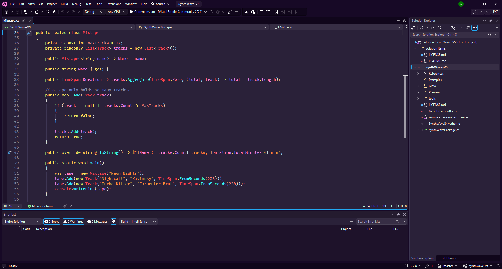
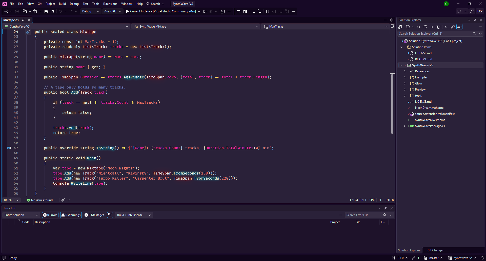

# SynthWave '84 - Visual Studio theme

[](https://marketplace.visualstudio.com/items?itemName=stillgbx.synthwave-vs)
[](https://github.com/stillgbx/synthwave-vs/actions/workflows/build.yml)
[](https://buymeacoffee.com/stillgbx)

A port of the awesome [SynthWave '84 - VS Code theme](https://github.com/robb0wen/synthwave-vscode 'SynthWave \'84 - VS Code theme') by [Robb Owen](https://github.com/robb0wen 'Robb Owen') to Visual Studio 2019, 2022 and 2026.

Two variants are included:

* **SynthWave '84**: the original token colors of the VS Code theme.
* **SynthWave '84 Neon Dream**: the colors of the VS Code "Neon Dreams" mode, with its neon glow (Visual Studio 2022 and later).

### SynthWave '84



### SynthWave '84 Neon Dream



## Install

### From the Visual Studio Marketplace

1. In Visual Studio, open *Extensions > Manage Extensions* and search for **SynthWave '84**, or install it from the [Marketplace page](https://marketplace.visualstudio.com/items?itemName=stillgbx.synthwave-vs).
2. Restart Visual Studio and pick the theme in *Tools > Theme*.

Visual Studio then keeps the extension up to date.

### From a release

1. Download `SynthWave-VS.vsix` from the [latest release](https://github.com/stillgbx/synthwave-vs/releases/latest).
2. Close Visual Studio, then double-click the file.
3. Start Visual Studio and pick the theme in *Tools > Theme*.

Installing a newer release updates the extension in place, no need to uninstall first.

### From source

1. Clone this repository and open `SynthWave-VS.sln`.
2. Build in Release, then run `bin\Release\SynthWave-VS.vsix`.

Press F5 instead to try your changes in the experimental instance of Visual Studio, without touching your main installation.

## Neon glow

With the Neon Dream theme, the extension draws the glow of the VS Code "Neon Dreams" mode around keywords, types, functions, tags and variables. It only applies to the text editor, and nothing in the Visual Studio installation is modified.

Turn it on or off and set its brightness in *Tools > Options > SynthWave '84 > Neon Glow*. Switching to another theme turns the glow off.

## Recommended fonts

* Text Editor: [FiraCode Medium](https://github.com/tonsky/FiraCode 'FiraCode Medium')
* Environment: [Roboto](https://fonts.google.com/specimen/Roboto 'Roboto Medium')
* All Text Tool Windows: [Roboto](https://fonts.google.com/specimen/Roboto 'Roboto')

If a color you changed yourself in *Tools > Options > Environment > Fonts and Colors* wins over the theme, click *Use Defaults* there.

## Credits

Theme colors, glow effect and icon come from [SynthWave '84](https://github.com/robb0wen/synthwave-vscode) by Robb Owen (MIT License).

## Development

### Editing the themes

Both variants share every environment color, only the text editor colors differ.
`NeonDream.vstheme` is the source: edit it, then apply the editor palettes and regenerate `SynthWave84.vstheme`:

```
python tools/generate-themes.py
```

The editor palettes of both variants are at the top of the script. To edit the environment colors visually, you can use the [Visual Studio Color Theme Designer 2022](https://marketplace.visualstudio.com/items?itemName=idex.colorthemedesigner2022 'Visual Studio Color Theme Designer 2022').

### Releasing

1. Increase `Version` in `source.extension.vsixmanifest`: Visual Studio only updates an installed extension to a higher version.
2. Push a tag with the same version, for example `v2.7`. The [Build](.github/workflows/build.yml) workflow builds the VSIX and attaches it to a new GitHub release.
3. Update the [Marketplace listing](https://marketplace.visualstudio.com/items?itemName=stillgbx.synthwave-vs): upload the new VSIX on [marketplace.visualstudio.com/manage](https://marketplace.visualstudio.com/manage), or run `VsixPublisher.exe` with `publishManifest.json`.
